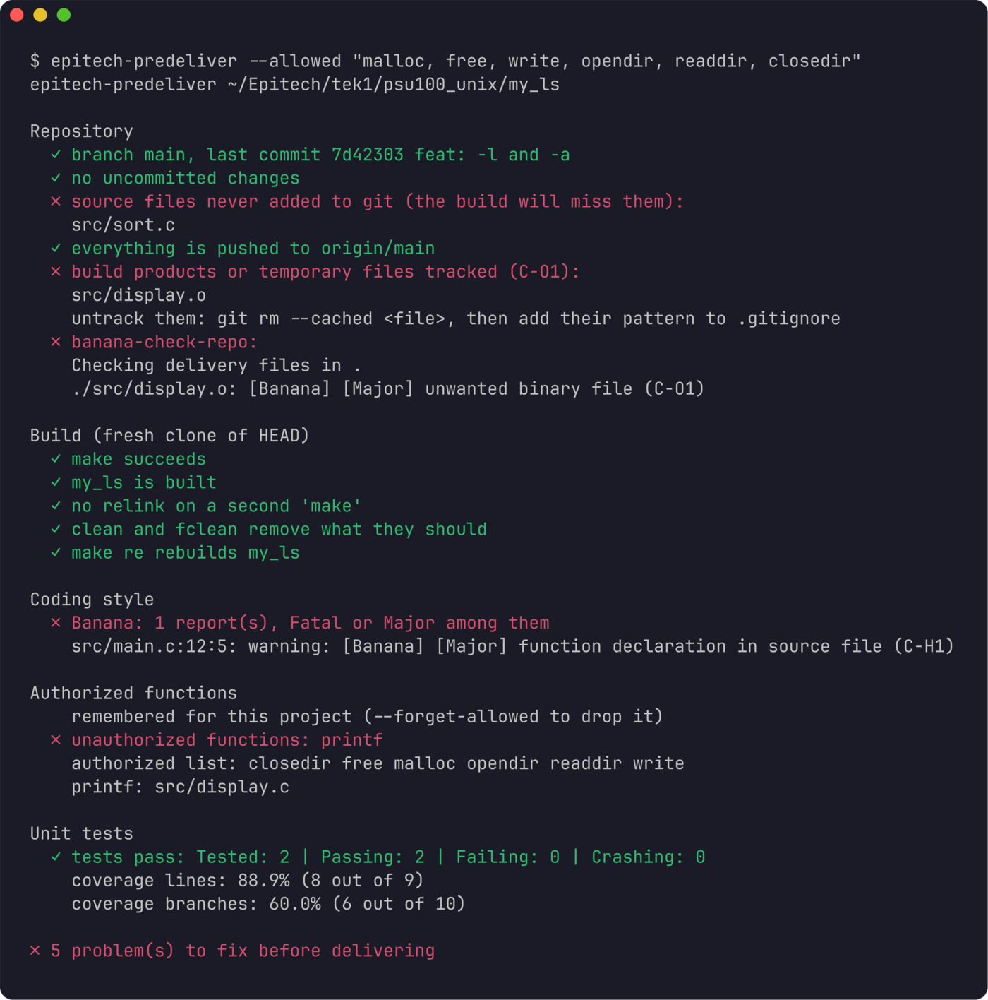

<p align="center">
  
</p>

<h1 align="center">epitech-toolkit</h1>

<p align="center">
  Your Epitech setup in one command, on Arch Linux and Ubuntu.
</p>

<p align="center">
  <a href="https://epitech.elliotmoreau.fr"></a>
  
  
  
  <a href="https://github.com/cempack/epi/releases/latest"></a>
  <a href="https://github.com/cempack/epitech.nvim"></a>
  
  <a href="LICENSE"></a>
</p>

<p align="center">
  
</p>

Everything the school's `dump.sh` installs, plus Neovim and VS Code set up for
the coding style, tools that check your project before the moulinette does, and
[`epi`](https://github.com/cempack/epi) to keep your Epitech folder organized.
It updates itself every week.

## Install

```sh
bash <(curl -fsSL https://raw.githubusercontent.com/cempack/epitech-toolkit/main/install.sh)
```

Run it as your user (it asks for sudo when it needs it), open a new terminal,
then check that everything works:

```sh
epitech-doctor
```

## What you get

| | |
|---|---|
| **School tools** | `epiclang` with Banana, `banana-check-repo`, Criterion, CSFML, `tcsh`, Teams |
| **Editors** | Neovim with LazyVim and [epitech.nvim](https://github.com/cempack/epitech.nvim), the Epitech extension for VS Code, the Epitech Vim and Emacs configs |
| **Development** | gcc, clang 21, gdb, valgrind, gcovr, make, lazygit, gh, ripgrep, fd, `mbake` |
| **Commands** | `epitech-predeliver`, `epitech-mem`, `epitech-doctor`, `epitech-upgrade`, `epi` |

## Commands

| | |
|---|---|
| `epitech-predeliver` | Clones what you **committed** and checks it like the moulinette: build on a fresh clone, relink, `clean`/`fclean`/`re`, Banana, authorized functions, unit tests. Exits 1 when something blocks the delivery. |
| `epitech-mem ./my_ls -l src` | Valgrind's report in plain words: each error and leak with the line of **your** code that caused it. `--asan` rebuilds with sanitizers instead. |
| `epitech-doctor` | Tests that things work (a Criterion test compiles and runs, Banana reports, the plugin loads) and gives the command that fixes each problem. |
| `epi` | Clones your projects into `tek1/<module>/<name>`, names them from their subject and files the subject PDFs. [More](https://github.com/cempack/epi). |
| `epitech-upgrade` | Updates everything now. A weekly timer runs it for you. |

<details>
<summary><b>What <code>epitech-predeliver</code> checks</b></summary>

- **Repository:** uncommitted changes, `.c`/`.h` files never added to git,
  unpushed commits, tracked build products (`.o`, `vgcore.*`, `a.out`,
  `unit_tests`, binaries, `.vscode/`…), large files, `banana-check-repo`.
- **Build, on a fresh clone:** `make` works without your local leftovers, the
  binary named by `NAME` appears, a second `make` doesn't relink, `clean`,
  `fclean` and `re` do their job, compiler warnings.
- **Coding style:** Banana on every tracked file.
- **Authorized functions:** every function the binary calls (`nm`), against the
  subject's list: `--allowed "malloc, free, write(2), sf*"`, remembered for the
  project. Calls the compiler writes itself (`printf("text\n")` becomes `puts`)
  are explained.
- **Unit tests:** `unit_tests`/`tests_run` pass, with coverage when gcovr is there.
- **Memory**, with `--run "ARGS"`: the program under valgrind.

`--no-tests` skips the tests, `--keep` keeps the clone to look at.
</details>

<details>
<summary><b>What <code>epitech-mem</code> prints</b></summary>

```
 MEMORY ERRORS
  ✗ reads 1 byte outside valid memory  (0 bytes after a block of size 8 alloc'd)
      at display.c:42 in print_name
           42 │ while (name[i] != '\0') {
      block allocated at parse.c:18 in add_entry
           18 │ entry->name = malloc(sizeof(char) * len);

 LEAKS
  ✗ 64 bytes in 2 blocks definitely lost
      allocated at parse.c:18 in add_entry

 FILES LEFT OPEN
  ! file descriptor 3 (src) never closed
      opened at list.c:12 in read_dir
```

A crash gets its own section with the line that crashed. `--full` adds
valgrind's whole report.
</details>

## Editors

**Neovim.** [LazyVim](https://www.lazyvim.org/) with
[epitech.nvim](https://github.com/cempack/epitech.nvim): format on save that
passes Banana, Banana's reports as you save, function length and nesting meters,
one-key fixes, project scaffolding, `make` and Criterion in the quickfix list. The
installer is careful with your config: no config gets the LazyVim starter, a
LazyVim config only gets `lua/plugins/epitech-dump-arch.lua`, any other config is
left alone.

**VS Code.** When `code`, `codium` or `code-oss` is installed, the
[Epitech extension](https://github.com/cempack/epitech.nvim/tree/main/vscode)
brings the same formatter, Banana's reports in the Problems panel, the meters and
**Epitech: New Project**. Installed VS Code later? Run `epitech-upgrade`.

## Arch or Ubuntu

The same command installs the same things; only where they come from differs.

| | Arch | Ubuntu |
|---|---|---|
| School packages | pacman and the AUR (Teams) | Epitech's PPA: `epitech-cpool` brings Banana, Criterion, CSFML, valgrind, tcsh… |
| epiclang and Banana | Epitech's PPA, unpacked into `~/.local` | apt, from the PPA |
| Neovim 0.11+ | pacman | the official release in `~/.local` (24.04 ships 0.9) |
| clang-format 21+ | pacman | `uv tool` in `~/.local/bin` |
| lazygit, Teams | pacman, the AUR | apt when it has them, else their GitHub releases |

On an Ubuntu release the PPA doesn't cover, Ubuntu's Criterion and CSFML are
used, and epiclang and Banana go into `~/.local` as on Arch.

## Updates

A weekly timer runs `epitech-upgrade`: epiclang and Banana, the Emacs and Vim
configs, epitech.nvim (never your other plugins), the VS Code extension, `epi`
and this project's commands. `epitech-upgrade --check` only reports.

System packages stay the package manager's (`yay -Syu`, `sudo apt upgrade`): the
updater never uses sudo, it tells you what to install when the installer adds
something new.

<details>
<summary><b>Install options</b></summary>

```sh
git clone https://github.com/cempack/epitech-toolkit.git
cd epitech-toolkit
./install.sh            # everything
./install.sh --no-sys   # no package manager or sudo: user-space parts only
```

Re-running is safe. With `--no-sys`, the editors and tools (including
`clang-format` 21+) must already be installed.
</details>

<details>
<summary><b>Uninstall</b></summary>

First, while epitech.nvim is still installed, run `:EpitechHooks remove` in the
repositories where you added its pre-push hook, and `:EpitechLazygit remove` if
you added its lazygit key. Then:

```sh
systemctl --user disable --now epitech-upgrade.timer
rm ~/.config/systemd/user/epitech-upgrade.{service,timer}
rm ~/.local/bin/{epitech-upgrade,epitech-doctor,epitech-predeliver,epitech-mem,epitech-emacs,epi}
rm ~/.local/bin/{epiclang,epiclang.py,banana-check-repo,teams-for-linux}
rm ~/.config/nvim/lua/plugins/epitech-dump-arch.lua
code --uninstall-extension cempack.epitech   # or codium / code-oss
rm -rf ~/.local/share/nvim/lazy/epitech.nvim ~/.local/share/nvim/epitech.nvim
rm -rf ~/.local/lib/epiclang ~/.local/share/epitech-upgrade ~/.local/share/epitech-dump-arch
```

On Ubuntu, also `rm -rf ~/.local/share/epitech-dump-arch/nvim ~/.local/bin/nvim`
and `uv tool uninstall clang-format` if the installer added them. Optionally
remove the packages (`sudo pacman -Rns`, `sudo apt remove`), the Epitech blocks
from `~/.emacs`, `~/.vimrc`, `~/.vim/epitech.vim` and
`~/.emacs.d/lisp/{epitech,site-start.d}`, and the `epi` line from `~/.bashrc`
(and `~/.zshrc`). The LazyVim starter stays: it may hold your own changes.
</details>

## Development

`test/run` runs the tests (set `EPITECH_NVIM_DIR` to test against a local
epitech.nvim checkout). The website is in [`site/`](site) and deploys on push.

Formerly `epitech-dump-arch`: the old address redirects. Files on disk keep that
name (`~/.local/share/epitech-dump-arch`, the LazyVim spec and its `Managed by`
line) so existing installs keep working.

<sub>Unofficial, not affiliated with Epitech. MIT license.</sub>
